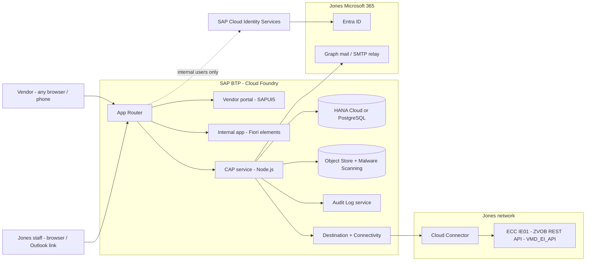
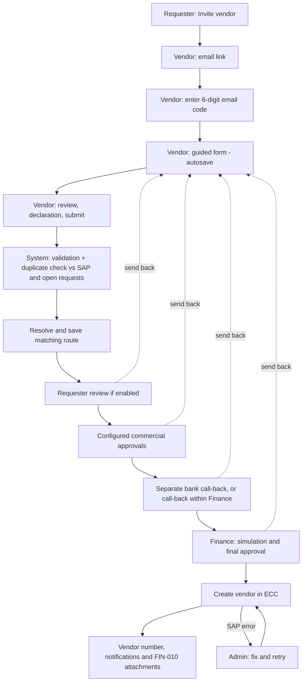

# Jones Vendor Onboarding (VOB): Solution Design v1

| | |
|---|---|
| Replaces | Paper/PDF form **FIN-010-IE01 Vendor Account Set up Form** (copy in [`reference/`](../reference/FIN-010-IE01-Vendor-Account-Setup-Form.pdf)) |
| Company | H. A. O'Neil Limited (Jones Engineering), company code **IE01** |
| SAP | ECC 6.0 EHP8 (SAP_BASIS 750) on HANA, DEV / QAS / PRD / TST, client 300 |
| Status | Design agreed for build. **Platform decided: Option 6, CAP on SAP BTP** ([ADR-001](decisions/ADR-001-platform-cap-on-btp.md)). Current owner workflow is in [AGENTS.md](../AGENTS.md) |
| Date | 2026-11-09 |

---

## 1. What we are building, in one paragraph

A Jones employee invites a vendor by email. The vendor opens a secure link, confirms a one-time code sent to their email, and completes a short guided form: company, contacts, tax, bank and documents. It saves automatically and works on a phone. After the vendor submits, the request is routed through the same approvals as the paper form: Requester, Purchasing Manager, Procurement (only for 30-day terms), Bank-details call-back and Financial Controller. Every step is tracked on one screen. Once the final approval is given, the vendor is created automatically in SAP ECC. It is the same vendor record XK01 creates, made through the SAP vendor API rather than by driving the XK01 screen. The vendor number comes back to the requester and the vendor. A filled-in copy of the familiar FIN-010 PDF, with the full approval trail, is attached to the vendor in SAP for audit.

## 2. What the current form contains (source of truth for fields)

The PDF has 2 pages and 53 fillable fields. Page 1 is for the vendor. Page 2 explains the account types and holds the internal sign-offs.

| Section | Fields (exact PDF field names in `code`) |
|---|---|
| Account type | `Material Supplier` (YBIV, 100XXX) · `Contract for Service` (YBCS, 600XXX) · `Supply of Personnel` (YBSP, 700XXX) · `Fully Contracted out Service` (YBVE, 800XXX) |
| General | `Company Name`, `Street Name/Number`, `District`, `City/County`, `Post Code`, `Country` |
| Contacts | `Accounts Contact Name`, `Accounts Email`, `Sales Contact Name`, `Sales Email` |
| Tax & registration | `CRO No`, `VAT Reg No`; subcontractor withholding tax: `RCT No` (IE only), `Tax Clearance Cert` (tick), `CIS No` (UK only), `UTR No` (UK only) |
| Banking (bank letter on headed paper also required) | `Bank Name`, `Bank Address`, `Bank Account No`, `Sort Code`, `Swift Code/BIC`, `IBAN` |
| Bank confirmation contact | `Contact Name`, `Contact Phone No` |
| Payment terms | `30 Days EOM` (*Procurement approval required*, `Approved By`), `60 Days EOM`, `90 Days EOM` |
| Trading currency | `Euro`, `GBP`, `USD`, `Other` (free text) |
| Sub-contractor documents | `Insurance Cert`, `Safety Statement`, `RCT Form`, `Sub-Contract Agreement` (each "copy provided") |
| Vendor sign-off | `Vendor Print Name`, `Vendor Signature` (signature field), `Completed On Date_af_date` |
| Internal use only | `Requested By` + `Date 1`, `Purchasing Manager` (sig) + `Date 2`, `Financial Controller` (sig) + `Date 3`, `Bank Confirmed By` (sig) + `Date 4`, `Created By` + `Date 5` |

The account-type explanations on page 2 are reused as help text in the app (§7.2).

---

## 3. Every option considered, and how easy each is to use

Rating: ●●●●● = best. "Codex can build & test" means the whole thing can be written as code and tested end to end on a laptop without SAP access, which is how we want to build.

| # | Option | Vendor ease | Approver ease | Tracking | Security (does ECC face the internet?) | Codex can build & test | Effort | Cost / licence | S/4HANA-ready |
|---|---|---|---|---|---|---|---|---|---|
| 1 | **Web Dynpro ABAP / FPM** in ECC + SAP Business Workflow | ●●○○○ dated, desktop-first | ●●○○○ SBWP / UWL inbox | ●●●○○ | ●○○○○ ECC must be exposed through a Web Dispatcher in the DMZ with an anonymous service user | ●○○○○ ABAP needs the system to compile/test | M–L | No new licence; external-user licensing to check | ●○○○○ WDA is not SAP's direction |
| 2 | **BSP** in ECC + Business Workflow | ●●○○○ hand-built HTML, old framework | ●●○○○ | ●●○○○ | ●○○○○ same exposure as 1 | ●○○○○ | L | As 1 | ●○○○○ legacy, no SAP investment |
| 3 | **SAPUI5 / Fiori on ECC Gateway** (on-prem) + Business Workflow / My Inbox | ●●●●○ | ●●●○○ needs Fiori launchpad + My Inbox | ●●●○○ | ●●○○○ Gateway still has to face the internet | ●●○○○ UI yes, OData/workflow ABAP no | L | No new licence | ●●●○○ |
| 4 | **SAP Build Process Automation (BPA) forms + workflow**, vendors as IAS users | ●●○○○ every vendor needs an account and login; basic forms, weak IBAN/VAT checks and conditional sections | ●●●●○ My Inbox / mobile | ●●●●○ process monitor | ●●●●○ BTP only | ●○○○○ built by clicking in the browser; Codex can't author or test it | S for simple, L once logic grows | Per-user/consumption; external logins count | ●●●●○ |
| 5 | **SAP Build Apps** front end + BPA workflow | ●●●○○ | ●●●●○ | ●●●●○ | ●●●●○ | ●○○○○ low-code, browser-built | M | Build Apps + BPA | ●●●●○ |
| **6** | **★ CAP application on SAP BTP** (pro-code; VS Code or SAP Business Application Studio) with a SAPUI5 vendor portal, a Fiori internal app, approvals in the app, and a thin ABAP API reached through the Cloud Connector | ●●●●● no account, magic link + email code, guided, mobile, autosave | ●●●●● one screen: task inbox, one-click approve, email deep links | ●●●●● timeline, status, ageing, audit | ●●●●● ECC stays private; outbound Cloud Connector tunnel only | ●●●●● all code; SAP mocked locally | M | Small CF runtime + DB + object store; no per-vendor licences | ●●●●● swap the ABAP API for `API_BUSINESS_PARTNER` |
| 6b | Option 6, with **approvals in BPA** and/or ECC traffic **through CPI** (EY-architecture variant) | ●●●●● | ●●●●○ tasks move to My Inbox, so two places to look | ●●●●○ split across app + BPA monitor | ●●●●● | ●●●○○ the BPA/CPI pieces are browser-built | M+ | + BPA / CPI message volume | ●●●●● |
| 7 | **SAP Ariba Supplier Lifecycle & Performance / Supplier Management** (buy) | ●●●●○ Ariba Network registration | ●●●●○ | ●●●●● | ●●●●● | n/a (configuration) | M (config + MDGI/CIG integration) | Significant unless already in the Ariba contract | ●●●●● |
| 8 | **SAP MDG for Suppliers** on ECC | ●●○○○ needs SLC/Ariba for vendor self-service | ●●●○○ | ●●●●○ | ●●○○○ | ●○○○○ | L | MDG licence | ●●●●○ |
| 9 | **Microsoft Power Pages + Power Automate (Teams approvals) + SAP ERP connector** | ●●●●○ | ●●●●● approvals inside Teams/Outlook | ●●●○○ | ●●●●○ on-prem data gateway | ●●○○○ partly code, flows are JSON/browser | M | Power Pages capacity + premium connector licences | ●●●○○ RFC calls change at S/4 |
| 10 | **E-signature web form** (Acrobat Sign / DocuSign) + manual XK01 | ●●●●○ | ●●●○○ | ●●○○○ | ●●●●● | n/a | S | E-sign licences | n/a (no SAP automation, stop-gap only) |

### Why not the others

- **Web Dynpro / BSP / on-prem Gateway (1–3).** Vendors are outside Jones, so ECC itself would have to accept internet traffic. Today SAP access goes through Zscaler ZPA, and opening ECC to the internet is the largest security risk on this list. The UX is dated (WDA/BSP), and the code can't be built or tested away from the SAP system.
- **BPA as the main tool (4, 5).** BPA has no anonymous or public form, so every vendor would need an IAS login, and external logins are counted for licensing. Its forms are fine for internal approvals but weak for a vendor form with IBAN checks, country-specific tax fields and document checklists. It is also built in the browser, so Codex can't build or test it end to end.
- **Ariba SLP (7).** This is the right answer *if* Jones' Ariba contract already includes SLP or Supplier Management; check with the Ariba account team before building anything. Otherwise it is a large subscription for one form.
- **Power Platform (9).** This is the strongest non-SAP alternative, and Teams approvals are excellent. It is still a second integration stack beside BTP/CPI, it needs an on-prem data gateway server, and it is harder for Codex to build and test as code.
- **"Business Studio".** SAP Business Application Studio is the *IDE*, not a runtime. Option 6 can be opened and extended in BAS by the SAP team, even though Codex builds it in VS Code.

### Recommendation: Option 6, CAP on SAP BTP

1. **Easiest for vendors.** No SAP account, no password: an email link plus a 6-digit code. The form is guided, checks entries as you type, saves automatically and works on a phone.
2. **Easiest for approvers.** One app, one "Waiting for me" list. An email deep link opens the request, single sign-on with the Jones Microsoft account logs you in, and one click approves.
3. **Fully trackable.** The status, the person it is waiting on, days in each step, a full timeline and an immutable audit log are all on one page. The vendor gets a simple "parcel-tracking" status page.
4. **Secure by design.** ECC never faces the internet. BTP handles the public side, and the only path to ECC is the outbound Cloud Connector tunnel to a single, narrow ABAP API with a technical user.
5. **Buildable by Codex end to end.** Everything is code. SAP is mocked locally behind an adapter, so the whole journey runs and is tested on a laptop. Going live means pointing the adapter at a BTP destination.
6. **Clean core and S/4HANA-ready.** The only ABAP is a small API wrapping the standard vendor API `VMD_EI_API`. At S/4 conversion it is replaced by the standard `API_BUSINESS_PARTNER` OData API and the app is untouched.
7. **Uses what Jones already has:** BTP global account, Cloud Connector, Cloud Identity Services trusted by Entra ID, and Microsoft 365 email.

> **Decision (2026-11-09): Option 6, CAP on SAP BTP, with approvals in the app.** Recorded in [ADR-001](decisions/ADR-001-platform-cap-on-btp.md).
> - Option 6b (BPA approvals and/or CPI) is **not** used in v1.
> - ECC calls go to a configurable HTTP destination. CPI can therefore be put in front of ECC later, at deployment, with no code change, if the Jones/EY architecture requires it.
> - Moving approvals to BPA would need a new ADR.

---

## 4. Architecture

| Layer | Technology | Notes |
|---|---|---|
| Runtime | SAP CAP (Node.js, JavaScript), one app | No microservices, no message broker, no multitenancy |
| Vendor UI | SAPUI5 freestyle app (`sap.m` wizard-style steps), Horizon theme | Public route; app-level auth (invite token + email OTP) |
| Internal UI | SAPUI5 **Fiori elements** (OData V4) List Report + Object Page, plus admin config pages | SSO via XSUAA, trusting IAS, trusting Entra ID |
| Approvals | CAP-native state machine + configuration tables | §6. No BPA ([ADR-001](decisions/ADR-001-platform-cap-on-btp.md)) |
| Persistence | SQLite (local/test) → HANA Cloud or PostgreSQL on BTP | DB-agnostic CDS; the choice depends on BTP entitlements |
| Files | Object Store + SAP Malware Scanning Service (local: file system + mock scanner) | `@cap-js/attachments` if it fits |
| Audit | `@cap-js/audit-logging` with `@PersonalData` annotations → SAP Audit Log service; plus an app audit table for the business timeline | |
| Email | Mail adapter: `local` (writes to `.outbox/` + dev mailbox page) · `graph` (Microsoft Graph sendMail through a destination) · `smtp` | |
| Background work | CAP persistent queue/outbox for SAP calls and emails (retries); `cds.spawn` timer for reminders, guarded by a DB lease | Single-instance assumption documented |
| SAP access | SAP adapter: `mock` · `http` (BTP destination → Cloud Connector → ECC ICF REST endpoint, or → CPI) | Same JSON contract either way (§9) |
| ECC | ABAP package `ZVOB`: ICF REST handler + vendor service wrapping `VMD_EI_API`, duplicate check, bank master, GOS attachment, idempotency table | abapGit format in `abap/`; ABAP 7.50 syntax |
| PDF | `pdf-lib`: fill the real FIN-010 AcroForm by field name, flatten, append audit-trail page | Auditors see the form they know |

---

## 5. User journeys

### 5.1 Requester (Jones employee)
1. **Invite vendor** button → a short dialog:
   - Required: company name, vendor contact name and email, account type, company code (IE01 default), payment terms (default from config), business reason / project.
   - **Account-type helper**: three plain questions that suggest the group, using the page-2 explanations: "Materials/equipment only?" → YBIV. "Labour only, under Jones supervision?" → YBSP. "An individual through their own limited company?" → YBCS. "Goods *and* labour, responsible for spec and quality?" → YBVE.
   - **Payment terms are set by Jones, not chosen by the vendor.** The route tester explains the configured approvals; the starting 30 EOM route includes Procurement.
2. The vendor gets the invite. The requester sees the request in "My requests" with live status and can resend the invite, correct the email (before the vendor starts) or cancel.
3. After submission, when requester review is enabled, the inviter does a quick **Requester review**: confirm account type, payment terms and currency; approve or send back.

### 5.2 Vendor
1. **Invite email**: Jones-branded. Names the requester and the reference (e.g. `VOB-2026-00042`) and says how to check the email is genuine. Never asks for a password.
2. **Open the link** → "We've sent a 6-digit code to j\*\*\*@acme.ie" → enter the code. The code goes in a separate email from the link.
3. **Before you start** screen: "About 10 minutes. Have ready: VAT number, bank letter on headed paper, and, for sub-contractors, insurance certificate, safety statement…" The list is driven by the account type.
4. **Steps**: Company → Contacts → Tax → Bank → Documents → Review & submit.
   - A progress bar; save and finish later; every field autosaves.
   - **Country first**: the country drives the fields. IE shows CRO, IE VAT format, RCT and Eircode. GB shows Companies House number, GB VAT, CIS/UTR and UK postcode. Fields that don't apply are hidden.
   - **IBAN first**: for IE/GB, sort code and account number are filled in from the IBAN, so they are not typed twice. Checks the mod-97 checksum, length per country, BIC format and BIC/IBAN country match.
   - Every field has a one-line "why we need this".
   - Documents: drag and drop, PDF/JPG/PNG, max 10 MB each, with a "valid until" date for insurance and tax clearance.
5. **Review & submit**: everything on one page with "Edit" per section. Declaration tick box, typed full name and auto date (replaces signature, print name and date). Submit → a reference number, a receipt email and a link to the status page.
6. **Status page** (same link + code): Submitted → Under review → Account created (shows the Jones account number) / Changes needed / Not approved. Internal comments are never shown.
7. **Sent back**: an email with the Jones message. The link opens the form with the flagged sections highlighted; the vendor fixes and resubmits.

### 5.3 Approvers
- An email "Vendor ACME Ltd is waiting for your approval" opens the request directly (SSO).
- The request page shows:
  - header: status, current step, waiting since, days open;
  - banners: possible duplicate, documents missing/expired, "changed since your last review";
  - the vendor data by section, with bank data masked except for roles allowed to see it;
  - a document viewer;
  - the timeline of every event.
- Actions: **Approve**, **Send back to vendor** (message + sections), **Reject** (reason required). The mobile layout works.
- **Bank verifier** gets a call-back panel:
  - IBAN breakdown and automatic checks;
  - the bank letter beside the data;
  - the vendor-provided contact, with a prompt to use an **independently sourced** number where possible;
  - fields: number called, number source, person spoken to, date/time, outcome (Confirmed / Not confirmed), notes.
- **Financial Controller** confirms the finance data (reconciliation account, withholding tax/RCT code, payment method; defaults come from config) and presses **Simulate in SAP**: a test run with no commit, showing SAP's messages in plain English. **Approve** is enabled only after a successful simulation; approving queues creation.

### 5.4 Master data admin
- **SAP errors** queue: plain-English message, a "Technical details" button and **Retry**. Retries are idempotent: they never create a second vendor. The admin can correct a limited set of finance fields and retry, or reject.
- **Configuration** pages (§8) and **Test SAP connection** (plain-English result + technical details).

### 5.5 Tracking
- List of all requests with status chips, filters (status, step, requester, account type, ageing), and variants **Waiting for me**, **All open**, **Created**, **Rejected/Expired**.
- Header counts: waiting for me · open · over SLA · created this month · average days to create (last 90 days).
- Export to Excel from the list (standard Fiori elements).

---

## 6. Workflow

[ADR-003](decisions/ADR-003-configurable-approval-routes.md) supersedes the original fixed approval chain. Admins configure routes; each request saves its route at the first submission.

### 6.1 Statuses and route resolution

| Status | Meaning / next |
|---|---|
| `INVITED`, `IN_PROGRESS` | Vendor opens the invitation, completes details and submits; invitations can expire or be cancelled |
| `SUBMITTED` | Transient validation and duplicate checks; select the first active matching route by ascending priority (ID breaks ties) |
| `PENDING_REQUESTER` | Inviter reviews first when the global requester-review setting is on (default) |
| `PENDING_PURCHASING`, `PENDING_PROCUREMENT` | Commercial steps included only when present in the saved route |
| `PENDING_BANK_CHECK` | Separate Bank verifier records a confirmed call-back before approval |
| `PENDING_FINANCE` | Last step: finance settings, successful SAP simulation and final approval; IN_FINANCE also requires a confirmed call-back here |
| `RETURNED` | Vendor fixes details and resubmits; restart every step of the same saved route, with a fresh call-back |
| `CREATING`, `SAP_ERROR` | Transactional SAP creation queue; automatic transient retries, then administrator correction/retry |
| `CREATED` | Vendor number stored; notifications and attachments |
| `REJECTED`, `CANCELLED`, `EXPIRED` | Closed; requester can resend an expired invitation or start a new request |

ApprovalRoutes stores priority, name, active, accountTypes, paymentTerms, companyCode, country, ordered steps and bankCheckMode. Values within a condition are alternatives; populated conditions must all match. Empty means any. An active conditionless default must always exist. Supported steps are REQUESTER, PURCHASING, PROCUREMENT, BANK_CHECK and FINANCE, with no duplicates and Finance last. Requester review is prepended globally when enabled, and removed when disabled.

| Priority | Starting route | Condition | Steps after requester review |
|---|---|---|---|
| 10 | Sub-contractors | YBCS, YBSP or YBVE | Procurement → Bank call-back → Finance |
| 20 | Short payment terms | 30EOM | Procurement → Bank call-back → Finance |
| 99 | Default | Any | Bank call-back → Finance |

The default route has one business approval (Finance), alongside requester review and independent bank verification. Sub-contractors and short terms have two (Procurement and Finance). Purchasing remains available for routes an admin explicitly configures.

### 6.2 Roles, bank modes and controls

| Step | Role collection | Responsibility | Reminder → escalation |
|---|---|---|---|
| Requester review | `VOB_Requester` (inviter only) | Business need, type, terms, currency | 2 → 5 working days |
| Purchasing | `VOB_PurchasingManager` | Commercial review when configured | 2 → 5 |
| Procurement | `VOB_ProcurementApprover` | Supplier/terms review when configured | 2 → 5 |
| Bank call-back | `VOB_BankVerifier` | Independent call, evidence and confirmation | 1 → 3 |
| Finance | `VOB_FinancialController` | Finance data, SAP simulation and final approval | 2 → 5 |
| Admin / Auditor | `VOB_MasterDataAdmin` / `VOB_Auditor` | Configuration and error recovery / read-only oversight | n/a |

- SEPARATE is the default. Bank verification precedes Finance, performed by a different person.
- IN_FINANCE is a per-route option for low-risk vendors: no separate BANK_CHECK step. Finance sees the call-back panel and cannot approve without confirmed evidence for the current submission/bank account. The editor warns that this removes the two-person bank check.
- The requester never acts on a later step, even if requester review is disabled. One person can act on only one step per submission round. Role pools and the approver directory determine recipients.
- Every resubmission restarts the saved route and invalidates old-round call-backs. Bank changes after send-back always need a new call-back.
- The snapshot includes step order, roles, labels, bank mode and reminder/escalation targets. Later configuration changes cannot reroute in-flight requests, including resubmissions. Legacy requests with no snapshot retain their original chain.
- Progress, task/reminder emails, What happens next, the request-specific How it works page and FIN-010 use that snapshot. Staff see **Route: … → …**. Generic How it works shows current configured routes; vendor status uses plain-language saved stages.
- Admin route cards provide condition checkboxes, editable ordered step chips, a requester-review toggle, validation and a tester for unsaved rules. Saving an invalid/defaultless route set is refused transactionally.

### 6.3 Automatic checks at submission (and again before creation)
- All field validation, re-run server-side.
- **Duplicates in SAP** (adapter): same VAT number, same IBAN, or same normalised name + postcode. Also duplicates among **open requests**.
- Results appear as banners to approvers, never to the vendor. An exact VAT or IBAN match with an active SAP vendor blocks final approval until an approver records a justification, or the requester cancels as duplicate ("extend the existing vendor instead").
- Required documents present and not expired.

---

## 7. Vendor form: fields, rules and SAP mapping

Codex must keep the SAP targets **configurable** where marked ⚙. Items marked **VERIFY IN DEV** are to be confirmed against Jones ECC (for example with XK03 on 3 existing vendors of each account group).

### 7.1 Field mapping

| PDF field | Portal field | Validation | SAP target (ECC) | Notes |
|---|---|---|---|---|
| Account type ticks | Set by requester (vendor sees it read-only with an explanation and a "doesn't look right?" note) | One of YBIV/YBCS/YBSP/YBVE | `LFA1-KTOKK` | ECC assigns the number internally from the account-group range |
| `Company Name` | Legal company name | Required, ≤140 chars | `NAME1`–`NAME4` (35 each, split at word boundaries); search term `SORTL` derived (20) | |
| `Street Name/Number` | Street and number | Required, ≤60 | `STREET` (+ `HOUSE_NUM1` if split) | |
| `District` | District / locality | Optional, ≤40 | `CITY2` | |
| `City/County` | Town / city, county | Required, ≤40 | `CITY1`; county → `REGION` ⚙ if Jones uses regions | |
| `Post Code` | Eircode / postcode | IE Eircode, GB postcode, other: ≤10 | `POST_CODE1` | ECC also checks the format per country (T005) |
| `Country` | Country (first question) | ISO 3166 alpha-2 list | `COUNTRY`; language `EN` | Drives all conditional fields |
| `Accounts Contact Name` | Accounts contact | Required | `LFB1-ZSABE` (clerk at vendor) ⚙ | |
| `Accounts Email` | Accounts email (remittances) | Required, email | `LFB1-INTAD` + address email (`ADR6`) ⚙ | |
| `Sales Contact Name` | Sales contact | Optional | `LFM1-VERKF` ⚙ | |
| `Sales Email` | Sales email | Optional, email | Contact person or second address email ⚙ VERIFY IN DEV | |
| — | Main phone | Optional, E.164-style | `TEL_NUMBER` / `LFM1-TELF1` ⚙ | New, useful for buyers |
| `CRO No` | Company registration no. (CRO / Companies House) | IE: digits; GB: 8 chars | Tax number field ⚙ (Q6) | |
| `VAT Reg No` | VAT number | Per-country format (IE `IE1234567X(X)`, GB `GB` + 9/12 digits, EU formats) | `LFA1-STCEG` (EU) / tax number for GB ⚙ | VIES check is phase 2 |
| `RCT No` | RCT tax reference (IE sub-contractors) | Shown if IE + sub-contractor type | Withholding tax ID `LFBW-WT_WTSTCD` for the RCT WHT type ⚙ | FC sets the WHT code/rate |
| `Tax Clearance Cert` | Upload + valid-until date | Required per config | Not stored in SAP; attached via GOS | |
| `CIS No`, `UTR No` | CIS number, UTR (UK sub-contractors) | Shown if GB + sub-contractor; UTR = 10 digits | WHT ID for the CIS type / tax number ⚙ | |
| `IBAN` | IBAN (asked first) | mod-97, length per country | `TIBAN` linked to `LFBK` | |
| `Sort Code`, `Bank Account No` | Derived from IBAN for IE/GB; typed for non-IBAN countries | 6 digits / 8 digits (IE/GB) | `LFBK-BANKL` (bank key ⚙: sort code or BIC, Q7), `LFBK-BANKN` | |
| `Swift Code/BIC` | BIC | `^[A-Z]{4}[A-Z]{2}[A-Z0-9]{2}([A-Z0-9]{3})?$`; warn if country ≠ IBAN country | `BNKA-SWIFT` | |
| `Bank Name`, `Bank Address` | Bank name and address | Required | `BNKA` (bank master); the API may create a missing bank (⚙, Q7) | |
| — | Account holder name | Default = company name | `LFBK-KOINH` | New; protects against mismatched accounts |
| `Contact Name`, `Contact Phone No` | Bank-details contact | Required | Not in SAP; used by the bank call-back | |
| 30/60/90 Days EOM | Set by requester | Route conditions determine approvals (seed: 30 EOM → Procurement) | `LFB1-ZTERM`, `LFM1-ZTERM` (keys ⚙, Q1) | |
| Euro/GBP/USD/Other | Trading currency | ISO 4217 list (default by country) | `LFM1-WAERS` | "Other" becomes a proper dropdown |
| Sub-contractor documents | Uploads per config | Required for YBCS/YBSP/YBVE (⚙, Q11) | GOS attachments on `LFA1` | |
| Vendor print name / signature / date | Declaration: tick + typed name; date and IP recorded | Required | n/a (stored in the app and the PDF) | |
| Internal sign-offs | Workflow steps with timestamps | n/a | `ZVOB_REQLOG` + PDF | `Created By` = technical user; approvers in the audit trail |
| — (internal) | Reconciliation account, payment methods, WHT type/code, purchasing org, GR-based IV flag | Defaults from config per account group | `LFB1-AKONT`, `LFB1-ZWELS`, `LFBW`, `LFM1` (`EKORG`, `WEBRE`) | Set or confirmed by the FC |

### 7.2 Help text (from page 2)
- **Material Supplier**: supplies or transports material, equipment or parts to or from site only.
- **Contract for Service**: an individual working through their own limited company, personally doing the work.
- **Fully Contracted out Service**: provides goods, materials *and* labour, agrees the specification, owns quality, and can profit beyond a percentage of workers' fees.
- **Supply of Personnel**: labour-only workers via a limited company, umbrella company or agency, paid hourly, daily, weekly or fixed sum, with no materials or tools, under Jones supervision.

---

## 8. Configuration (admin pages, seeded with placeholders)

| Table | Content |
|---|---|
| Company codes | IE01 (H. A. O'Neil Limited): purchasing org ⚙, active flag. Others (GB01…) added later |
| Account types | Code, label, help text, sub-contractor flag, required documents, default reconciliation account per company code, default WHT type |
| Payment terms | `30EOM`/`60EOM`/`90EOM` → SAP `ZTERM` per company code; approvals now come from ApprovalRoutes |
| Currencies | ISO list; default per country |
| Document types | Bank letter (all), tax clearance, insurance, safety statement, RCT1 (Q11), sub-contract agreement; required per account type; needs a valid-until date |
| Withholding tax | Per company code + country + account type: WHT type and allowed codes (e.g. RCT 0/20/35 %) |
| Approval routes | Priority, conditions, ordered steps, active flag, bank-check mode; see §6 and ADR-003 |
| Approver directory | Role → notification email list |
| Settings | Invite expiry (30 days), reminder days, escalation days, OTP lifetime, retention, sender address, portal base URL, privacy notice URL, feature flags, requesterReviewEnabled (default true) |

Admin-editable tables get their starting values from `srv/seed/` when the app starts: only empty tables, plus any missing setting names. They are not HDI table data, so a redeploy never overwrites business changes (deviation D10). The role directory is not seeded in production; Admin → Configuration lets master data admins maintain notification recipients, warns when a role pool is empty, and prevents removing the last recipient from a pool. Populate every role pool before live approvals. Countries, currencies and WHT codes stay deployment-managed in `db/data`.

---

## 9. ECC integration contract

The CAP SAP adapter calls a JSON REST API. In production it is served by the ABAP ICF handler `/sap/zvob/v1/` through the Cloud Connector, or by CPI proxying to it; the contract is identical either way. The mock adapter implements the same contract in memory/DB, numbering per account-group range.

| Method + path | Purpose | Notes |
|---|---|---|
| `GET /ping` | Connection test | Returns system, client, release, user |
| `POST /duplicates` | Duplicate check | `{companyCode, name, postCode, country, vatNumber, iban}` → `{matches:[{vendorNumber, name, city, matchedOn:[VAT|IBAN|NAME_POSTCODE], blocked}]}` |
| `POST /vendors` with `testRun: true` | SAP simulation | No commit; returns SAP messages |
| `POST /vendors` | Create | Idempotent on `requestId` (`VOB-YYYY-NNNNN`); returns `CREATED` or `ALREADY_CREATED` + `vendorNumber` |
| `GET /vendors/{lifnr}` | Read back for verification | |
| `POST /vendors/{lifnr}/attachments` | GOS attachment (FIN-010 PDF, bank letter, documents) | Base64 content |

- Responses carry `messages:[{type S|W|E, id, number, text, field?}]`.
- HTTP 422 means business errors: show them to the admin in plain English with technical details.
- HTTP 5xx or a timeout means a transient error: retry with backoff, then `SAP_ERROR`.

**ABAP package `ZVOB`** (abapGit format, ABAP 7.50 syntax):
- `ZCL_VOB_REST_HANDLER` (`IF_HTTP_EXTENSION`): routing and JSON via `/UI2/CL_JSON` (fallback: sXML).
- `ZCL_VOB_VENDOR_SERVICE`: builds `VMDS_EI_MAIN` (central, address, bank, company code IE01, withholding tax, purchasing org). Calls `VMD_EI_API=>MAINTAIN_BAPI` with `IV_TEST_RUN`/`IV_COLLECT_MESSAGES`, then `COMMIT WORK AND WAIT` only when there are no errors. Internal numbering per account group (`VMD_EI_API=>GET_NUMBER` VERIFY IN DEV).
- `ZCL_VOB_DUPLICATE_CHECK`: LFA1/LFBK/TIBAN reads through an interface so ABAP Unit can use test doubles.
- Bank master: create the missing `BNKA` entry with `BAPI_BANK_CREATE` (only when config allows).
- GOS: `SO_DOCUMENT_INSERT_API1` + `BINARY_RELATION_CREATE_COMMIT` on object type `LFA1`.
- Table `ZVOB_REQLOG` (request ID → LIFNR, status, payload hash, timestamps) for idempotency and traceability.
- Technical user with minimal authorisations: `F_LFA1_APP`, `F_LFA1_GRP` (four groups only), `F_LFA1_BUK` (IE01), `M_LFM1_EKO`, `F_BNKA_MAN`, GOS. Basis confirms. The Cloud Connector exposes only the path `/sap/zvob/v1/`.
- Known SAP caveats to check: if CVI/BP synchronisation is active in ECC, vendor creation behaves differently (SAP KBA 3738190). Bank data and IBAN field names in `VMDS_EI_*` are VERIFY IN DEV.

---

## 10. Security and controls
- **Vendors**: invite token of 256 random bits, stored as a SHA-256 hash, expiring and revocable. The email OTP has 6 digits, lasts 10 minutes and allows 5 attempts before a 15-minute lock. The session is HttpOnly, Secure, SameSite=Strict, with a 2-hour sliding expiry. Each session is scoped to its single request. Rate limiting covers OTP requests and verification. CSRF protection covers all state-changing calls.
- **Bank data**: after submission the vendor sees it masked; to change it they re-enter it. Internal lists show only the last 4 digits. Full values are visible only to the bank verifier, FC and admin, and each view is audit-logged.
- **Authorisation and SoD**: enforced on the server, never only in the UI. Every action checks the role, the status, and the person's earlier steps on that request.
- **Uploads**: type allow-list (PDF/JPG/PNG), size limit, malware scan before any internal user can open a file. Infected files are rejected with a friendly message.
- **Audit**: an event table (no general update/delete API) plus the SAP Audit Log service for sensitive bank reads. Event prose is minimized to event labels. As a retention exception, old event details and vendor actor identifiers are scrubbed after the retention period while event type, timestamp and staff actor remain.
- **Headers and privacy**: CSP, HSTS, no-sniff and frame-deny headers. A privacy notice link in the portal footer once Jones supplies the notice URL (Q16).
- **Retention (⚙)**: anonymise rejected/expired/cancelled requests after 12 months (implemented in the scheduled reminder/expiry job, `cds.requires.vob.jobMinutes`: personal, tax and bank fields, documents, versions, approval comments, call-back evidence, links, codes and stored emails are removed; old audit message/details and vendor actor identifiers are scrubbed while event type/time and staff actor remain); keep created ones 7 years.
- **No secrets in the repo.** Destinations and credentials live in BTP service bindings only.
- **Dev-only login switcher** for local testing, impossible to enable in the production profile.

## 11. Non-functional
- Volume is low: tens of requests per month. Simplicity beats scale.
- WCAG 2.2 AA; mobile first for the vendor portal; English only in v1.
- Errors are plain English with a next step; technical details sit behind a button (admin only).
- Environments: local (SQLite, mocks, fake users) → BTP dev subaccount with SAP DEV → QAS → PRD.

## 12. Phase 2 backlog (not in v1)
1. **Vendor change requests**, especially bank changes, with mandatory call-back. This is the most common invoice-fraud route.
2. Extend existing vendors to other company codes (GB01, NL01, …).
3. Import a completed FIN-010 PDF to pre-fill a request (for vendors mid-flight).
4. VIES and HMRC VAT checks; Revenue eRCT rate lookup.
5. Teams adaptive-card approvals; delegation and out-of-office.
6. Insurance and tax-clearance expiry reminders to vendors (v1 already stores the valid-until dates).
7. Power BI cycle-time reporting.
8. A CPI pass-through iFlow in front of ECC, only if the Jones/EY architecture requires it (config only, no app change). Moving approvals to BPA is out of scope unless a new ADR supersedes [ADR-001](decisions/ADR-001-platform-cap-on-btp.md).

## 13. Open questions for Jones (non-blocking: the build uses placeholders)

| # | Question | Default used in the build |
|---|---|---|
| Q1 | SAP payment-term keys for 30/60/90 days EOM in IE01 | `Z030`/`Z060`/`Z090` placeholders |
| Q2 | Reconciliation account per account group (IE01) | Placeholder `0000000000` per group |
| Q3 | Purchasing org(s) for IE01; is purchasing data created at creation time (central XK01)? | Yes, one purchasing org placeholder |
| Q4 | Default payment method(s) (`ZWELS`) | Placeholder |
| Q5 | WHT types/codes for RCT (0/20/35 %) and CIS; who sets them | FC selects from config |
| Q6 | Where CRO, RCT and UTR numbers are stored today (check existing vendors in XK03) | Configurable field mapping |
| Q7 | Bank key convention for IE/GB (sort code or BIC); may the API create missing banks? | Sort code; creation allowed but behind a flag |
| Q8 | Is CVI / BP synchronisation active in ECC? | Assume no |
| Q9 | Bank call-back before Financial Controller (recommended) or after (PDF order)? | Before |
| Q10 | Is "Procurement approval" (30 EOM) a different person from the Purchasing Manager? | Separate role |
| Q11 | Required documents per account type; is the paper RCT1 still needed (Revenue moved to eRCT in 2012)? | Required for YBCS/YBSP/YBVE; RCT1 optional |
| Q12 | BTP entitlements: HANA Cloud or PostgreSQL, Object Store, Malware Scanning, Audit Log, custom domain | Both DB profiles possible; HANA Cloud first |
| Q13 | Identity: IAS tenant trusting Entra ID; role-collection mapping from Entra groups | Role collections as in §6.2 |
| Q14 | Email: Microsoft Graph app registration (send as `noreply@joneseng.com`?) or SMTP relay | Graph adapter, local adapter in dev |
| Q15 | Does the EY BTP architecture require CPI in front of ECC? (BPA for workflows: **decided no**, [ADR-001](decisions/ADR-001-platform-cap-on-btp.md)) | Direct Cloud Connector; adapter ready for CPI |
| Q16 | Retention periods | 12 months / 7 years |
| Q17 | Branding (logo, colours) and vendor-facing domain | Neutral Jones wordmark; `vendors.joneseng.com` placeholder |
